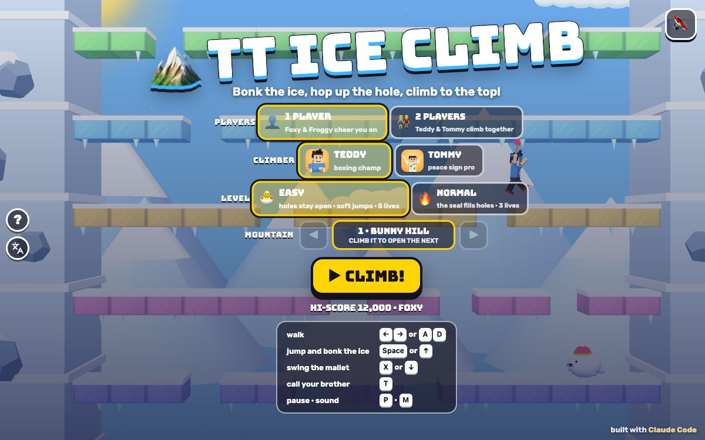

# TT Ice Climb

Press **?** any time (or tap the round **?** button on the left edge) to see the keys. The game waits while you look.
Tap the language button under it (the A文 icon) to switch between English and 中文; the dashboard and every game remember the choice.

**中文：** 冰山攀登：Teddy 和 Tommy 拿着玩具锤子爬冰山！跳起来敲碎头上的冰块，再从洞里跳上去，踩着云朵，把海豹和小鸟敲得打喷嚏飘走。到了山顶，跳上云朵抓住大鸟带着的大蔬菜。一共 8 座冰山。

A climbing game on a tall snowy mountain, starring Teddy and Tommy in winter beanies with squeaky toy mallets. The mountain is built of colourful layers of ice: jump straight up and the mallet bonks the block over your head, then hop up through the hole. Drifting clouds carry you sideways, a roly-poly snow seal in a knit hat waddles along the layers (and on NORMAL pushes ice back into the holes), and little birds flutter about. At the top is the bonus stage: hop up the clouds and grab the giant vegetable a friendly big bird carries. 8 mountains.

A 3D game for the boys, built with Claude Code from plain JavaScript and Three.js on the shared Claude Games kit. The climbers are the kit's blocky Teddy and Tommy; the seal, the birds and the big bird are our own toy models. There are no image, model or audio files: every texture is painted on a canvas and every sound is synthesised. The name, the characters, the mountains and the sounds are our own; nothing is copied from any arcade game. Nobody gets hurt: a bump makes you dizzy, a bonked seal sneezes "ACHOO!" and floats away in a bubble, a bonked bird goes "PUFF!" in confetti.

## Play

- **Double-click `index.html`.** It works offline because Three.js and the kit are copied into `kit/`. Without internet the title font falls back to Arial Black.
- **Send one file:** `dist/ice-climb-tt.html` is the whole game in one page, about 850 KB. AirDrop or email it, then open it in a browser.
- Rebuild that file after any edit: `python3 kit/tools/bundle.py . --name ice-climb-tt`

On the title screen pick **1 PLAYER** (then the climber: Teddy or Tommy) or **2 PLAYERS** (Teddy and Tommy climb together), the level, the **MOUNTAIN** (every mountain you've climbed opens the next one, for each level), and press **▶ CLIMB!** Behind the menu the autopilot climbs a demo.

**Levels:**

- **🐣 EASY** (the default, for Tommy, 5): holes stay open (the seal just waddles), a softer, floatier jump that's easy to steer, 5 lives, one slow seal and one slow bird at a time, 60 seconds for the bonus stage. Falling off the bottom of the screen never costs a life.
- **🔥 NORMAL** (for Teddy, 8): the seal pushes ice back into the holes, a snappier jump, 3 lives, more and faster seals and birds (birds sometimes swoop at you), 40 seconds for the bonus stage, and in 1 player a fall off the bottom of the screen costs a life.

An extra life comes every 20,000 points.

## The mountain

- **Ice layers:** each mountain has 8 layers of ice above the snowy ground, a new colour on every layer. Under a block, **jump**: the mallet bonks that one block (just the one right over your head) and you bounce back down. Jump again and you hop up through the hole and land on its edge (with no key held, a little landing help steers you onto the nearest ice). Walk over a hole and you drop to the layer below.
- **Hard snow** (white, speckled) never breaks: go round it. Every patch of ice you can stand on has a way up, when the mountain is made.
- **Clouds:** some layers are a gap with a smiling cloud drifting back and forth. Jump up through a cloud from below and land on top; it carries you along.
- **The screen scrolls up only.** It follows the highest layer anybody has stood on. Fall below the bottom of the screen and you **float back up in a bubble** to the lowest layer on screen.
- **The snow seal** (a round white seal in a red hat) waddles along a layer and turns at holes. On NORMAL it brings a block of ice and pushes it into the first hole it finds ("PLOP!"), then goes home for another. Touching it from the side bumps you (dizzy, and a life); swing the mallet at it, jump on it, or bonk the block it stands on from below, and it sneezes off in a bubble.
- **Little birds** flutter across the screen. Touching one bumps you; swing at it or jump into it and it puffs away in confetti.
- **The bonus stage:** landing on the top ice layer starts the bonus timer and every seal and bird floats away. Above are four layers of clouds (still ones at the sides, drifting ones in the middle) with little vegetables to grab, and on top the summit cloud with a pink flag. A friendly big orange bird flies back and forth over the summit carrying the mountain's **giant vegetable**: 🥕 🌽 🍅 🥦 🥔 🫑 🥒 🎃. Jump up and grab it! When the timer runs out the mountain ends without it.

The 8 mountains: **BUNNY HILL, SNOWBALL PEAK, CLOUDY TOP, POLAR POINT, ICICLE RIDGE, MARSHMALLOW MOUNTAIN, RAINBOW RIDGE, SUPER SUMMIT**, each with more hard snow and more cloud layers than the one before.

**Points:** a block of ice 10, each new layer 100, a seal 400, a bird 800, a little vegetable 300, the giant vegetable 3,000 on EASY or 5,000 on NORMAL (plus 500 for each mountain), the brother's treat 100, a high five 50.

**HI-SCORE:** the HUD shows the best score for the level and the mountain you're on, and the box on the right shows the layer you've reached (then the bonus timer). The **TOP CLIMBERS** board keeps the best five for each level, with 🦊 Foxy and 🐸 Froggy's scores to beat (in 1 player they cheer on little clouds at the bottom corners).

## 2 players

Teddy and Tommy climb the same mountain together, each with his own score and lives. The screen follows the higher climber; if the other one ends up below the bottom of the screen, a bubble carries him up beside his brother (in 2 players that never costs a life). A brother who runs out of lives sits out; the game ends when both are out. **T** is a high five (+50 each, and confetti).

## Controls

| | 1 player | 2 players: Teddy | 2 players: Tommy | Touch |
|---|---|---|---|---|
| walk | ← → or A D | A D | ← → | ◀ ▶ |
| jump (bonks the ice over your head) | Space, ↑ or W | W or Space | ↑ | ⤴️ JUMP |
| swing the mallet | X, ↓ or S | S or F | ↓ | 🔨 BONK |
| call your brother (2 players: high five) | T | T | T | tap his face (✋) |
| pause · sound | P or Esc · M | | | ❚❚ · 🔊 |

- You can steer in the air: hold ← or → during a jump. With nothing held, the landing help steers you onto the nearest ice when you come down.
- **Touch:** the buttons show up on phones and tablets, clear of the play area and of the kit's buttons on the left edge. In 2 players each brother gets his own pad (Teddy's on the left, Tommy's on the right).
- **Menus:** on the title screen 1 and 2 pick the players, E and N the level, C swaps the climber, ← → pick the mountain, Enter or Space starts. Paused: P, Esc or Space go on, Q goes to the menu. Results: Enter plays again, Esc goes to the menu.

## Call your brother (companion mode)

Call the other brother (`Kit.roster.buddyFor`: Tommy for Teddy, Teddy for Tommy) with **T**, by tapping his face button, or by clicking his face under your score, **as often as you like**: there's no waiting (a new call is taken as soon as the last smash has happened).

- **He pops in on a little cloud** next to you at his roster `buddyScale`.
- **He does his signature move:** Tommy's Y with peace fingers ✌️; Teddy's boxing, or (on the next call) his jump shot with a 🏀.
- **He tosses you a treat** (🍦 💧 🧃 🍪 🍉 🍌, a different one each call): +100.
- **Then the game's helper:** "TOMMY SAYS: SMASH!" He zooms along the layer above you with his mallet and **breaks the whole row of ice** (hard snow stays), so you can hop straight up. A seal standing on that row sneezes off. While he's visiting nothing can bump you.
- **In the bonus stage** there's no ice to smash, so he cheers instead: "TOMMY SAYS: GO GO GO!" and the timer gets 5 more seconds.
- **2 players:** both brothers are climbing, so T is a **HIGH FIVE! ✋** (+50 each).

## The end

Grab the giant vegetable and the climbers do their signature moves on the summit with confetti: **MOUNTAIN CLEAR!**, and the next mountain starts. After the 8th mountain it's **TOP OF THE WORLD!** When the lives run out (or after the 8th mountain), the climber (in 2 players both brothers) does his signature move in front of the mountain with confetti, and the results show the score, the **TOP CLIMBERS** board (**⭐ NEW HI-SCORE!** or **⭐ ON THE BOARD!**) and **↻ PLAY AGAIN**.

## How it works, and how it's tested

- `js/mountains.js`: the 8 mountains, made from a fixed seed each and checked as they're made (every patch you can stand on has ice or a hole above it). `js/sim.js`: the rules, in fixed 1/60 s steps: walking, jumping and bonking, the landing help, clouds, the screen scrolling, bubbles, the seal, the birds, the bonus stage, points, lives, 2 players and the brother's visit. `js/bot.js`: the autopilot (it times its hops onto drifting clouds, chooses holes with a way further up, and drops down a hole when it's stuck under hard snow). None of them uses Three.js, so node runs them.
- `js/art.js` builds the mountain (the ice is instanced, so a whole mountain is a few draw calls) and the characters, `js/sfx.js` the sounds (all through `Kit.sound`, so the mute switch covers them; counted in `IC.sfx.log`), `js/game.js` the camera, screens, keys, touch, HUD, celebrations and the test hooks. `js/friends.js` adds 🦊 Foxy and 🐸 Froggy to the roster (copied from TT Barrel Climb). The name lives in `js/title.js`.
- **The headless check:** `node tools/check.js` (or `game.check()` in the page), 11 checks in about a second:
  - *autopilotEasy:* the autopilot climbs every mountain on 🐣 EASY on three seeds each and grabs the giant vegetable, and plays a whole game of all 8 mountains in one go.
  - *jumpBreaksOnlyAbove:* from every spot on every layer of every mountain (three positions per block, including where the head pokes under the next block too), a jump under ice breaks exactly the one block right above (1,704 jumps), a jump under a hole breaks nothing and lands on the layer above (525), and hard snow never breaks (267).
  - *scrollsUpOnly:* the screen never scrolls down in whole games (1 and 2 players, both levels, about 53,000 steps), and when a climber drops three layers the screen stays put and the bubble brings him back.
  - *lowerNeverStuck:* in 32 two-player climbs (the lower brother standing still, or mashing keys, on both levels), whoever is below the screen is always in a bubble on its way up, and every bubble lands him back on the screen.
  - plus the brother's smash (every ice block in the row above, nothing else, and he can be called again), holes staying open on EASY (and seals refilling them on NORMAL), clouds carrying you, bumps and bonks (and no bumps during the brother's visit), the bonus stage and its timer, lives and falls, and whole games on NORMAL.
  - **It can fail:** `node tools/check.js --fail` (or `game.checkFail()`) switches on six sabotages one at a time (an autopilot that stands still, a jump that breaks three blocks, a screen that follows the lowest climber down, a bubble that never rises, a smash that breaks nothing, seals filling holes on EASY) and every one is caught.
- **The real-key play check:** `game.playCheck()` in the page (191 checks, about a second and a half) presses keys with real `keydown`/`keyup` events on `window` and taps the touch pads with pointer events, never the autopilot. On all 8 mountains, on an ice layer and on the summit cloud, for Teddy, Tommy and both brothers in 2 players (A D and ← →, each moving only his own brother), with keys and with touch: → moves right and ← moves left on screen, the jump goes up the screen and lands, the swing key swings. Nothing leaves you stuck: dizzy after a bump, the bubble after dropping off the screen, walking off a drifting cloud, the brother's visit, a key held through pause, 15 jumps up holes with → held (never ending inside the ice), and a "keyboard kid" mashing keys with seals and birds about on every mountain. `game.playCheck('mirror')` (left and right swapped, 133 failures) and `game.playCheck('stuckDizzy')` (the keys stop working after a bump) both fail it.
- **In the browser** (headless Chrome over the DevTools protocol, `tools/shoot.js` with the step files in `tools/`, the page opened from the disk): every screen in 中文 (`Kit.lang.untranslated()` returns `[]` on the title in both modes, the ? panel, play, the brother's smash, the seal and bird pops, pause, the bonus stage, the giant vegetable and mountain clear, the next mountain, time up, game over, 2 players with touch, the high five and a brother out, and the 2-player and all-8-mountains results), no Chinese in English mode (only the kit's language button, which names 中文 on purpose), sounds counted in code while muted, the ? panel freezing the game with real frames, phone 390x844, 844x390 and 740x360, iPad 1024x768 and 820x1180, and 1280x800 with touch in 1 and 2 players (no scrolling, no button over another, nothing under the kit's left-edge buttons, the play area clear of the touch pads, the smallest tap target 62 px), and `dist/ice-climb-tt.html` from `file://` with no page errors (the play check and the headless check pass there too).
- `docs/screenshot.jpg` is the title at 1200x750: `node tools/shoot.js tools/shots.json docs 1200 750`.

## Not verified

- **Sound:** every sound is synthesised and counted in code, but nobody has listened to it (tests ran muted): the ice crunches, the seal's sneeze, the bird's puff, the bubble bloop, the fanfares.
- **Real devices:** touch was driven with synthetic pointer events in emulated phones and iPads, not on a real iPad or iPhone. The frame rate was only seen in software rendering (about 150 draw calls a frame), not on an older iPad. On a phone held upright the 16 columns make the climbers small (the title suggests turning it sideways).
- **Real kids:** how hard Easy and Normal feel was tuned with the autopilot, not with Teddy and Tommy; the autopilot climbs a mountain in about 20 seconds, a kid will take longer.
- **Long sessions,** a real Finder double-click, the home-screen icon on a real iPad, the 🫑 emoji on older devices, and the offline font fallback.
